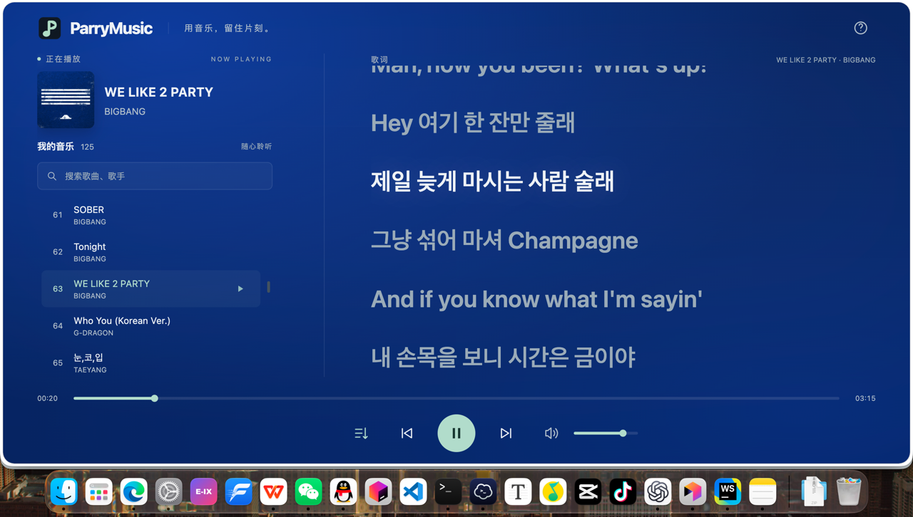

<div align="center">
  <a href="https://github.com/HuParry/ParryMusic"></a>
  <br>
</div>

<div align="center">

# ParryMusic · 静态音乐播放器

_✨ 一款完全无后端的纯静态音乐播放器 ✨_
</div>

## 📖 介绍

一个无需部署后端或数据库的音乐网站。你只需要提供音乐源文件，便可搭建一个十分像样的音乐播放器。

支持播放 / 暂停、切歌、进度拖动、音量、搜索、顺序播放、单曲循环、随机播放、点击歌词跳转和歌曲链接分享。

## 💿 安装

项目的部分功能依赖 Node.js，你需要提前安装好 [Node.js](https://nodejs.org/zh-cn/download)（18及以上版本）。

将项目源代码 clone 到本地：
```shell
git clone git@github.com:HuParry/ParryMusic.git
```

新版发布后更新版本：
```shell
git pull
```

首先跳转到项目中的 `music` 目录下。

### 1. 放入音乐

所有的音乐源文件都应放到`music`目录下。
```
music/
    名称/
      歌手5 - 歌名5.flac
      歌手6 - 歌名6.mp3
  歌手1 - 歌名1.mp3
  歌手2 - 歌名2.mp3
  歌手3 - 歌名3.mp3
  歌手4 - 歌名4.flac
```
- 文件名统一使用「歌手 - 歌名」，分隔符 ` - ` 两侧需有空格，例如 `The Chainsmokers - Closer.mp3`；多个歌手用 `&` 分隔，例如 `G-DRAGON&JENNIE - Black.flac`。

歌词请使用 UTF-8 编码的标准 LRC，例如：
```text
[00:00.00]第一行歌词
[00:12.50]第二行歌词
[00:25.00]第三行歌词
```

没有歌词、封面文件没有关系，但是音乐文件一定要有。

### 2. 生成歌单

本机安装 Node.js 18 或更新版本，在项目目录运行：
```shell
node scripts/generate-playlist.mjs
```

脚本递归扫描 music 文件夹，生成 `music/playlist.js`；每次新增、删除、重命名音乐、封面或歌词后，都要再运行一次。

默认会联网补全本地缺失的资源，歌词和封面资源来自于：

- 歌词接口：[https://api.lrc.cx/lyrics](https://api.lrc.cx/lyrics)；
- 封面接口：[https://api.lrc.cx/cover](https://api.lrc.cx/lyrics)；

接口获取的歌词和封面不一定是正确的，如果碰到不正确的情况，还是需要自己去手动获取歌词和封面资源。

- 接口获取的文件与音乐同名，例如「歌手 - 歌名.lrc」和「歌手 - 歌名.jpg」。再次运行时直接使用本地文件，不覆盖已有歌词或封面。
- 接口每次请求最长等待 45 秒；找不到结果、超时或内容无效时提示原因，并继续生成歌单。失败的资源下次运行时会重新尝试。

接口说明见 [LrcApi 项目](https://github.com/HisAtri/LrcApi)、[歌词文档](https://docs.lrc.cx/docs/legacy/lyrics/)和[封面文档](https://docs.lrc.cx/docs/legacy/cover/)。

如果需要仅扫描本地文件、不调用 API 时运行：
```shell
node scripts/generate-playlist.mjs --offline
```

**静态网页无法自行列出 music 目录中的对象。仅上传音频而未更新歌单，页面不会出现新歌。** 

所有歌曲会按以下格式写入platlist.js：

```js
window.PARRY_MUSIC_PLAYLIST = [
  {
    "id": "7c9e2a4b1f08",
    "name": "歌名",
    "artist": "歌手",
    "url": "./music/歌手 - 歌名.mp3",
    "cover": "./music/歌手 - 歌名.jpg",
    "lrc": "./music/歌手 - 歌名.lrc"
  },
  {
    "id": "abcdef123456",
    "name": "另一首歌",
    "artist": "歌手1&歌手2",
    "url": "./music/歌手1%26歌手2 - 另一首歌.mp3"
  }
];
```

所有地址相对于 index.html，使用 ./music/ 开头的路径。网页只接受本站的音频、封面与歌词地址，不请求外部音乐服务。手动填写时，文件名中的 #、?、% 分别编码为 %23、%3F、%25；生成脚本会自动完成编码（包括多个歌手之间的 `&`）。手动歌单省略 name 或 artist 时，网页也使用相同的文件名解析规则补全；显式填写的字段优先。

脚本根据「歌手 - 歌名」推断信息，不读取 ID3 标签；重新生成会覆盖手动修改的歌曲信息，但保留已有歌曲顺序，新歌追加到末尾，已删除的歌曲会自动移除。

### 3. 上传到 OSS（可选）

该小节需要利用到阿里云OSS，如果你选择其他途径来提供网页服务，可以跳过这一小节。

教程：[上传到 OSS](docs/oss-guide.md)

**完成一切后打开网站，点击播放即可听歌。** 

## ⚙️ 网站设置

编辑 `config.js` 可修改标题、描述、默认封面、初始音量和播放模式：

```js
window.PARRY_MUSIC_CONFIG = {
  title: "ParryMusic",
  subtitle: "用音乐，留住片刻。",
  defaultCover: "./img/default-cover.svg",
  volume: 0.8,
  playMode: "sequence" // sequence 按顺序播放；single 单曲循环；random 列表随机播放
};
```

空格：播放 / 暂停；← →：上一曲 / 下一曲；↑ ↓：音量。输入搜索、调整进度或操作按钮时，快捷键不会抢占这些控件。

## 🎉 本地预览与验证

可以双击 index.html 试听已配置的音乐。读取歌词需要 HTTP(S)；在电脑或测试服务器上启动预览：

    node scripts/preview.mjs 8080

访问 [http://localhost:8080/](http://localhost:8080/)。使用项目提供的预览脚本验证播放、进度拖动和歌词跳转；脚本支持音频 Range 分段请求。这是开发预览工具，部署 OSS 后不需要运行它。

默认监听 `0.0.0.0`，其他机器可通过 `http://服务器IP:8080/` 访问。将「服务器IP」替换为实际地址，并确保网络可达、服务器防火墙或安全组允许客户端访问该端口。命令中的 `8080` 可改为其他端口。

若只需本机访问，可指定监听地址：
```shell
node scripts/preview.mjs 8080 127.0.0.1
```

## 最终效果



## 项目结构

    index.html                     网站入口
    config.js                      网站配置
    manifest.json                  相对路径的网站清单
    css/main.css                   响应式界面
    js/player-core.js              歌词解析、资源路径和播放队列
    js/player-progress.js          播放进度显示与原生跳转交互
    js/main.js                     浏览器播放、歌词和交互
    img/                           本站图标与默认封面
    music/playlist.js              静态歌单
    music/                         你的音乐、封面和歌词
    scripts/generate-playlist.mjs   本地歌单生成与歌词/封面下载工具
    tests/                         无依赖测试
